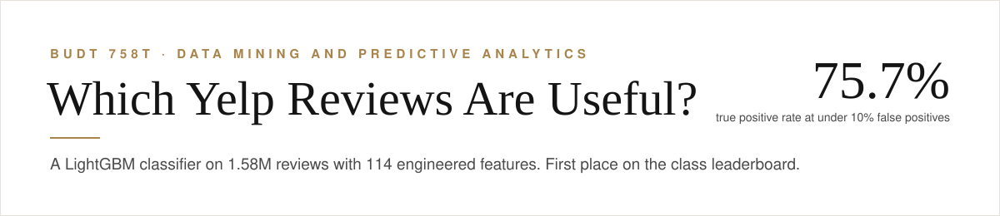
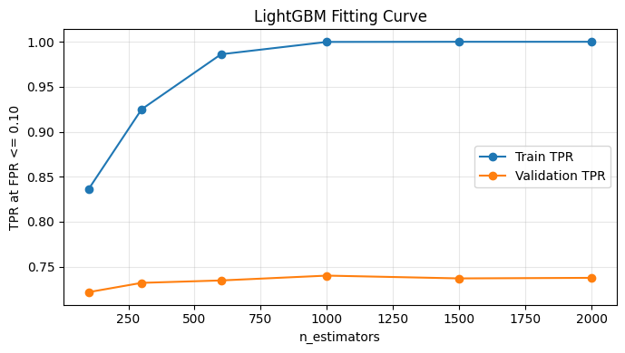

**First place on the class leaderboard.** 75.7% true positive rate at a 9.9% false positive rate on the held-out test set.

Yelp sorts reviews by date or by the votes they already have, so a useful review posted yesterday sits under a three-word review from 2015. We trained a model to guess which reviews will end up voted "useful" so they could go to the top on day one. The model sees the review text, the business, and the reviewer. It never sees votes.

**Data:** Yelp Open Dataset, course split. 1.58M reviews from 15,000 businesses in 15 U.S. states and one Canadian province, with user and business profiles and tips. Plus one outside feature: households per zip code from the 2021 Census.
**Course:** BUDT 758T Data Mining and Predictive Analytics, University of Maryland Smith School, Spring 2026. Team of 5. Scored on true positive rate with false positives capped at 10%.

---

## Result

| Model | Validation TPR at FPR 0.10 | Notes |
|---|---|---|
| **LightGBM** | **0.7525** | test 0.7567, 1,954 trees with early stopping |
| XGBoost | 0.7512 | 800 trees, full data |
| sklearn GradientBoosting | 0.7294 | 200K-row subsample |
| Random Forest | 0.6916 | 200K-row subsample |
| Decision Tree | 0.6784 | best at depth 12 |
| Logistic Regression | 0.6758 | train and validation scores almost equal, so the model is too simple, not over-regularized |

5-fold cross-validation on a 200K sample: mean 0.7357, standard deviation 0.0099. Every model used the same split and the same 114 features.



## What predicts a useful review

<p>
  
  
</p>

- **Who wrote it.** Reviews by regular users get voted useful 7.2% of the time. Reviews by users with 7+ years of Elite status: 39%. The strongest single signal in the data
- **How long it is.** Useful reviews average 993 characters. The rest average 507
- **How harsh it is.** 1-star reviews are useful 19.1% of the time, 5-star reviews 9.4%. Complaints tend to say exactly what went wrong; praise tends to be short
- **When it was posted.** The first 10% of reviews a business gets are useful 20% of the time; later ones, 7%. The two most important features in the model are the review's age and where it falls in the business's history
- **Businesses people argue about.** When a business's ratings are spread more than 4 stars apart, its reviews are useful at twice the normal rate (24.7%)


## The 114 features

Ten groups, all built in the notebook: the star rating (rescaled), 24 features about the writing itself (length, capital letters, pronouns, positive and negative words, comparison words), date features, the reviewer's profile, the business's profile and attributes, tip counts, comparisons (this review's length against the business's average, the gap between the reviewer's stars and the business's average), per-business and per-reviewer averages, and four K-fold target encodings.

## What went wrong, and the fix

One early submission scored 0.73 on our validation set and 0.59 on the leaderboard. The problem: when we retrained on the full training set, the K-fold target encodings on the training rows got replaced with encodings built from all the data, so each row's encoded feature included its own label. The fix keeps the K-fold values on training rows and uses the full-data encodings only on the test set. Done right, target encoding was still the biggest single gain of any feature group.

One limit we could not fix: a third of the test reviews are by users who never appear in training, so all their user features fall back to the median. A separate model for those rows is the obvious next step.

## My role

I made the team's first leaderboard submission, took part in the method discussions at each round, kept the team's schedule, and wrote the reflections section of the report.

## Repository

```
notebooks/yelp_review_usefulness.ipynb   feature engineering, LightGBM, five baselines, diagnostics, insights
figures/                                 18 charts exported from the notebook
docs/final_report.pdf                    24-page report with the full feature table
```

The dataset is not included (Yelp's license does not allow redistribution). The notebook ran on Kaggle; set `PATH` to your copy of the course files.

**Tools:** Python (pandas, NumPy, scikit-learn, LightGBM, XGBoost, matplotlib), Kaggle
