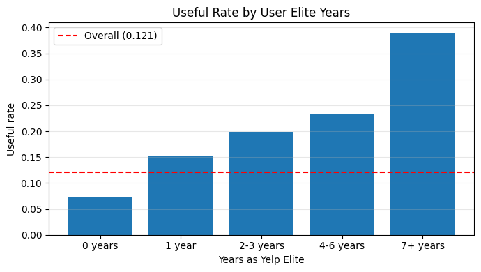
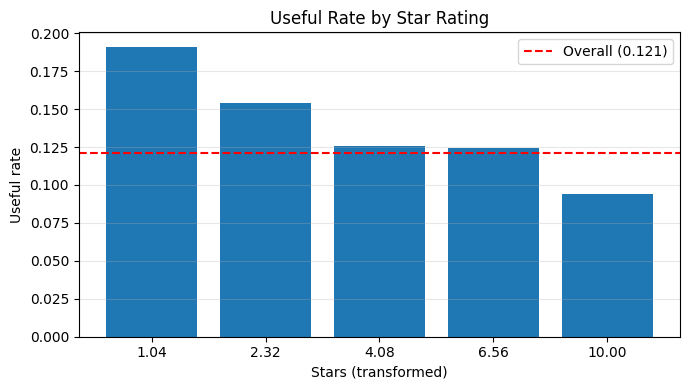
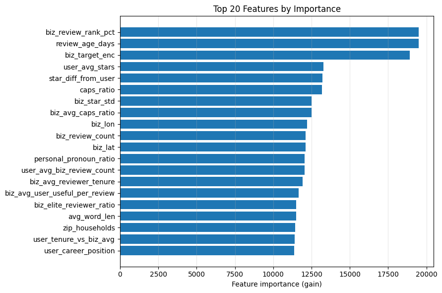

**First place on the class leaderboard.** 75.7% true positive rate at a 9.9% false positive rate on the held-out test set.

Yelp sorts reviews by date or by votes already collected, so a useful review posted yesterday sits under a three-word review from 2015. We trained a model to predict which reviews will end up voted "useful" so they could be ranked first from day one. The model only sees the review text, the business, and the reviewer. It never sees votes.

**Data:** Yelp Open Dataset, course split. 1.58M reviews from 15,000 businesses in 15 U.S. states and one Canadian province, with user and business profiles and tips. Plus one outside feature: households per zip code from the 2021 Census.
**Course:** BUDT 758T Data Mining and Predictive Analytics, University of Maryland Smith School, Spring 2026. Team of 5. Scored on true positive rate with false positives capped at 10%.

---

## Result

| Model | Validation TPR at FPR 0.10 | Notes |
|---|---|---|
| **LightGBM** | **0.7525** | test 0.7567, 1,954 trees with early stopping |
| XGBoost | 0.7512 | 800 trees, full data |
| sklearn GradientBoosting | 0.7294 | 200K-row subsample |
| Random Forest | 0.6916 | 200K-row subsample |
| Decision Tree | 0.6784 | best at depth 12 |
| Logistic Regression | 0.6758 | train and validation nearly equal: underfit, not over-regularized |

5-fold cross-validation on a 200K subsample: mean 0.7357, standard deviation 0.0099. Same split and the same 114 features for every model.


## What predicts a useful review

<p>
  
  
</p>

- **Who wrote it.** Reviews by non-Elite users are voted useful 7.2% of the time. Users with 7+ Elite years: 39%. Strongest single feature in the data
- **How long it is.** Useful reviews average 993 characters; the rest average 507
- **How harsh it is.** 1-star reviews are useful 19.1% of the time, 5-star reviews 9.4%. Complaints carry specific warnings; praise is usually short
- **When it was posted.** The first 10% of reviews on a business are useful 20% of the time, falling to 7% later. The top two features in the model are review age and where the review falls in the business's history
- **Polarizing businesses.** When a business's star spread is above 4, its reviews are useful at twice the base rate (24.7%)



## The 114 features

Ten groups, all built in the notebook: raw star rating (transformed), 24 text-style features (length, caps ratio, pronouns, sentiment words, comparison words), date features, user profile, business profile and attributes, tip counts, interaction features (this review's length vs. the business's average, star gap between reviewer and business), per-business and per-user aggregations, and four K-fold target encodings.

## What went wrong, and the fix

An early submission scored 0.73 on validation and 0.59 on the leaderboard. The cause: when retraining on the full training set, the K-fold target encodings on training rows were overwritten with full-data encodings, so each row's encoded feature contained its own label. The fix keeps K-fold values on training rows and uses full-data encodings only on the test set. Target encoding was still the single largest gain of any feature group once it was done right.

The other limit we could not fix: 33% of test reviews come from users not in training, so their user features fall back to medians. A cold-start model for those rows is the obvious next step.

## My role

Made the team's first leaderboard submission, took part in the method discussions at each round of evaluation, coordinated the team's schedule, and wrote the reflections section of the report.

## Repository

```
notebooks/yelp_review_usefulness.ipynb   feature engineering, LightGBM, five baselines, diagnostics, insights
figures/                                 18 charts exported from the notebook
docs/final_report.pdf                    24-page report with the full feature table
```

The dataset is not included (Yelp's license does not allow redistribution). The notebook ran on Kaggle; set `PATH` to your copy of the course files.

**Tools:** Python (pandas, NumPy, scikit-learn, LightGBM, XGBoost, matplotlib), Kaggle
